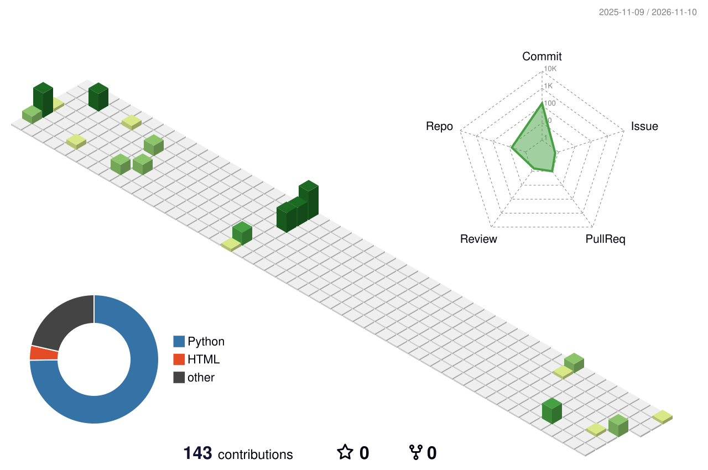

# Hi there, I'm Shreshtha Kumar! 👋

Welcome to my GitHub profile! I am a student developer passionate about solving problems through code and building efficient software.

### 🔭 About Me
- 🎓 **Branch:** Computer Science and Engineering
- 🎯 **Core Focus:** Web Development, Data Structures & Algorithms, Artificial Intelligence
- 🚀 **Current Exploration:** Diving deeper into Python, Django, and Machine Learning to architect scalable web apps and integrate AI into real-world projects.

### 🌐 Connect with me:

  
  

### 🛠️ Languages and Tools:

  

---

### 📊 GitHub Activity & Streak

  

  

  
  

---

### 🟩 3D Contribution Board

  

